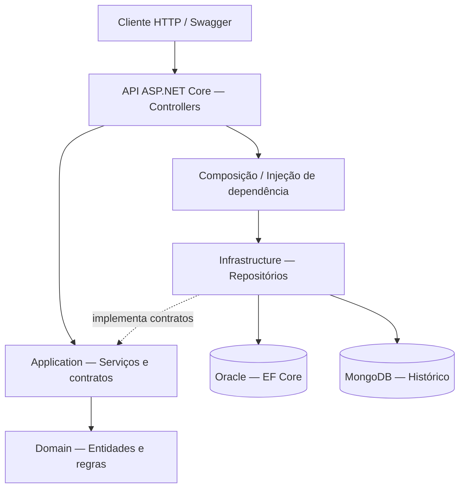

# 🐾 ClyvoCare OS — Advanced Business Development with .NET | Sprint 4

API REST desenvolvida para a gestão da saúde de animais de estimação, com cadastro de tutores e pets, acompanhamento de vacinas, consultas veterinárias e tratamentos, além de um histórico de atividades armazenado no MongoDB.

O projeto foi desenvolvido como entrega acadêmica da **FIAP — Sprint 4**, com foco em organização por camadas, persistência relacional e NoSQL, segurança, observabilidade e testes automatizados.

## 👥 Equipe

| Integrante | RM |
|---|---|
| Marina Tamagnini Magalhães | 561786 |
| Vitória Valentina Maglio | 563509 |
| Felipe Maglio Filho | 563512 |
| Mateus Granja dos Santos | 564930 |
| João Pedro Bitencourt Goldoni | 564339 |

## 🎯 Funcionalidades

- Cadastro, consulta, atualização e exclusão de **tutores** e **pets**.
- Gerenciamento de **vacinas**, **consultas** e **tratamentos** veterinários.
- Consultas especializadas de pets por nome, espécie e fase de vida.
- Histórico relacional do pet com vacinas, consultas e tratamentos.
- Histórico de atividades persistido em **MongoDB**.
- Listagem paginada de pets com filtros, ordenação e links HATEOAS (`self`, `prev`, `next`).
- Autenticação demonstrativa por **JWT** e mecanismo legado de **API Key**.
- Documentação interativa com **Swagger/OpenAPI**.
- Monitoramento com **Health Checks**, logs estruturados e telemetria.
- Testes automatizados com **xUnit** e coleta de cobertura.

## 🛠️ Tecnologias

| Área | Tecnologias |
|---|---|
| API | .NET 8, ASP.NET Core Web API, C# |
| Banco relacional | Oracle Database, Entity Framework Core, Migrations |
| Banco NoSQL | MongoDB, MongoDB.Driver |
| Segurança | JWT Bearer e autenticação legada por API Key |
| Documentação | Swagger / OpenAPI |
| Observabilidade | Health Checks, Serilog, OpenTelemetry, Prometheus |
| Testes | xUnit, testes unitários e de integração, cobertura Cobertura XML |

## 🧱 Arquitetura

A solução está dividida em projetos .NET independentes para separar responsabilidades e reduzir o acoplamento.

| Projeto | Responsabilidade |
|---|---|
| `src/ClyvoCare.Domain` | Entidades e regras do domínio |
| `src/ClyvoCare.Application` | Serviços de aplicação, casos de uso, contratos de repositórios e paginação |
| `src/ClyvoCare.Infrastructure` | Persistência Oracle/EF Core, migrations, repositórios e MongoDB |
| `ClyvoCareOSChallenge` | Controllers HTTP, injeção de dependência, JWT, Swagger, middlewares e monitoramento |
| `tests/ClyvoCareOSChallenge.UnitTests` | Testes unitários |
| `tests/ClyvoCareOSChallenge.IntegrationTests` | Testes de integração |

### Diagrama simplificado



**Refatoração da Sprint 4:** os controllers de **Pets, Tutores, Vacinas, Consultas e Tratamentos** passaram a utilizar serviços e repositórios, removendo referências diretas a `AppDbContext` desses cinco controllers. A compilação dos seis projetos e os testes automatizados foram executados após a refatoração.

> O diagrama representa o fluxo lógico das operações. As dependências de compilação seguem a separação de projetos definida na solução.

## ⚙️ Pré-requisitos e configuração

- .NET SDK compatível com os projetos `net8.0`.
- Acesso a uma instância Oracle e ao respectivo esquema.
- MongoDB Server disponível.
- Certificado HTTPS local confiável para execução em desenvolvimento.

Entre na pasta que contém `ClyvoCareOSChallenge.sln` e execute:

```powershell
dotnet restore
dotnet build
dotnet test
```

Caso os novos projetos não estejam registrados na solução extraída, adicione-os com:

```powershell
dotnet sln add .\src\ClyvoCare.Domain\ClyvoCare.Domain.csproj
dotnet sln add .\src\ClyvoCare.Application\ClyvoCare.Application.csproj
dotnet sln add .\src\ClyvoCare.Infrastructure\ClyvoCare.Infrastructure.csproj
```

### Configurações privadas

Configure as chaves abaixo com **User Secrets** (ambiente Development) ou variáveis de ambiente. Não inclua valores reais no GitHub.

```text
ConnectionStrings:OracleConnection
MongoDB:ConnectionString
MongoDB:DatabaseName
Jwt:Issuer
Jwt:Audience
Jwt:Key
DemoAuth:Password
Authentication:ApiKey
```

A chave `Jwt:Key` deve ser uma chave forte, aleatória, em Base64, compatível com a configuração de assinatura adotada na API. Use `dotnet user-secrets init` apenas se o projeto ainda não tiver `UserSecretsId`.

### Executar a API

```powershell
dotnet run --project .\ClyvoCareOSChallenge.csproj --launch-profile https
```

No perfil HTTPS testado:

- **Swagger UI:** `https://localhost:7087/` (**rota raiz**, conforme `RoutePrefix = string.Empty` no `Program.cs`).
- **OpenAPI JSON:** `https://localhost:7087/swagger/v1/swagger.json`.
- **Liveness:** `https://localhost:7087/health/live`.
- **Readiness:** `https://localhost:7087/health/ready`.

As URLs e portas podem variar conforme o arquivo `launchSettings.json` e o ambiente.

## 🌐 Principais endpoints

| Método | Rota | Descrição |
|---|---|---|
| GET / POST | `/api/tutores` | Listar / cadastrar tutores |
| GET / PUT / DELETE | `/api/tutores/{id}` | Consultar / atualizar / excluir tutor |
| GET / POST | `/api/pets` | Listar / cadastrar pets |
| GET / PUT / DELETE | `/api/pets/{id}` | Consultar / atualizar / excluir pet |
| GET | `/api/pets/especie/{especie}` | Pesquisar por espécie |
| GET | `/api/pets/fase/{fase}` | Pesquisar por fase de vida |
| GET | `/api/pets/buscar/{nome}` | Pesquisar pelo nome |
| GET | `/api/pets/{id}/historico` | Histórico relacional do pet |
| GET / POST | `/api/vacinas` | Listar / cadastrar vacinas |
| GET / PUT / DELETE | `/api/vacinas/{id}` | Consultar / atualizar / excluir vacina |
| GET / POST | `/api/consultas` | Listar / cadastrar consultas |
| GET / PUT / DELETE | `/api/consultas/{id}` | Consultar / atualizar / excluir consulta |
| GET / POST | `/api/tratamentos` | Listar / cadastrar tratamentos |
| GET / PUT / DELETE | `/api/tratamentos/{id}` | Consultar / atualizar / excluir tratamento |
| POST | `/api/auth/login` | Login demonstrativo e emissão de JWT |
| GET | `/api/auth/validar` | Validação de JWT com papel Admin |
| POST | `/api/historico-atividades` | Registrar atividade no MongoDB (JWT) |
| GET | `/api/historico-atividades/pet/{petId}` | Consultar atividades no MongoDB (JWT) |
| GET | `/api/seguranca/protegido` | Endpoint protegido pelo mecanismo legado de API Key |

Os parâmetros adicionais e os corpos das requisições estão descritos no Swagger.

### Paginação e HATEOAS

A rota `GET /api/pets` suporta os parâmetros `page`, `pageSize`, `nome`, `especie`, `sortBy` e `order` e responde com os campos `items`, `page`, `pageSize`, `totalItems`, `totalPages` e `links`.

Exemplo:

```http
GET /api/pets?page=1&pageSize=5&sortBy=id&order=asc
```

O campo `links` inclui `self` e, quando aplicável, `prev` e `next`.

## 🗃️ Persistência

**Oracle / Entity Framework Core:** banco relacional responsável pelos dados de tutores, pets, vacinas, consultas e tratamentos. A migration `20260519202528_InitialCreate` foi aplicada e reconhecida pelo EF Core como concluída no ambiente de desenvolvimento utilizado nos testes.

Para consultar as migrations da solução reorganizada:

```powershell
dotnet ef migrations list --project .\src\ClyvoCare.Infrastructure\ClyvoCare.Infrastructure.csproj --startup-project .\ClyvoCareOSChallenge.csproj
```

Não aplique migrations em outro esquema sem validar previamente as alterações.

**MongoDB:** armazena o histórico de atividades de pets. A integração de gravação e leitura foi testada durante o desenvolvimento, separadamente da persistência relacional.

## 🔐 Autenticação e segurança

- JWT Bearer com validação de emissor, audiência, assinatura e validade.
- Endpoint demonstrativo de login com usuário `admin` e senha configurada fora do código-fonte.
- Endpoint de validação protegido com papel `Admin`.
- API Key legada mantida para compatibilidade com rotas e testes anteriores.
- Middleware global de exceções.
- Logs estruturados e identificador de correlação (`X-Correlation-ID`).

**Observação:** o usuário demonstrativo não representa um sistema de identidade de produção. Para uso real, são necessários gestão de contas, senhas com hash e autorização adequada aos recursos. A validação de existência do pet no Oracle antes de registrar eventos no MongoDB é uma melhoria identificada.

## 🧪 Testes automatizados e cobertura

Na última execução compartilhada após a refatoração:

| Indicador | Resultado |
|---|---|
| Projetos compilados | **6 de 6** |
| Testes xUnit | **21 aprovados** |
| Testes com falha | **0** |
| Health Check de prontidão | **HTTP 200 — Healthy** |

Comandos:

```powershell
dotnet test
dotnet test --collect:"XPlat Code Coverage"
```

Relatórios: `tests/**/TestResults/**/coverage.cobertura.xml`.

Em uma medição anterior à última refatoração, os relatórios separados indicaram **15,67% de cobertura de linhas em integração** e **3,05% em testes unitários**. São métricas de execuções distintas, **não devem ser somadas** e não representam a cobertura consolidada da versão final. A cobertura deve ser medida novamente após a refatoração.

### Evidências de testes funcionais em Oracle

- **Pets:** POST `201`, GET bem-sucedido, PUT com alteração consultada, DELETE `204` e GET posterior `404`.
- **Tutores:** POST `201`, GET e PUT realizados; DELETE `204` no registro de teste.
- **Vacinas:** POST, GET e DELETE `204` testados.
- **Consultas:** POST, GET e DELETE `204` testados.
- **Tratamentos:** POST, GET e DELETE `204` testados.
- **Listagem dos quatro módulos:** HTTP `200` após a refatoração.
- **Swagger:** interface aberta e testada na raiz `/`.
- **Readiness:** HTTP `200 — Healthy` no ambiente utilizado.

Os testes de PUT de Vacinas, Consultas e Tratamentos foram preparados, mas as respostas e os valores posteriores **não foram compartilhados integralmente**; por isso não são declarados aqui como validados. O mesmo vale para uma taxa consolidada de cobertura.

## 📌 Estado da entrega

A solução tem projetos separados, controllers de negócio desacoplados do `AppDbContext`, DI, Oracle, MongoDB, JWT, documentação Swagger, observabilidade e testes automatizados. A compilação e os 21 testes foram aprovados após a refatoração.

Para uma avaliação final, recomenda-se conferir os cenários de erro e autorização de todos os endpoints, ampliar a cobertura automatizada dos novos repositórios/serviços e validar o comportamento de escrita/atualização dos quatro módulos em ambiente isolado.

---

**FIAP — Advanced Business Development with .NET — Sprint 4**  
**ClyvoCare OS | Saúde e cuidado animal com tecnologia**
