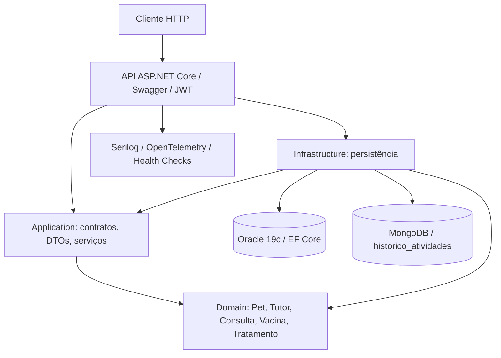

# Arquitetura ClyvoCare OS

## Limitação arquitetural identificada

O projeto foi fisicamente separado em assemblies com orientação correta das dependências entre Domain, Application e Infrastructure. Entretanto, **controllers legados** ainda utilizam `AppDbContext` diretamente para operações CRUD; isso deve ser migrado para casos de uso e interfaces da Application para alcançar Clean Architecture rigorosa. O `PetsController` já delega as operações GET principais ao `PetQueryService`. O endpoint Mongo usa contrato da Application. Não declarar 100% de Clean Architecture antes dessa migração.
